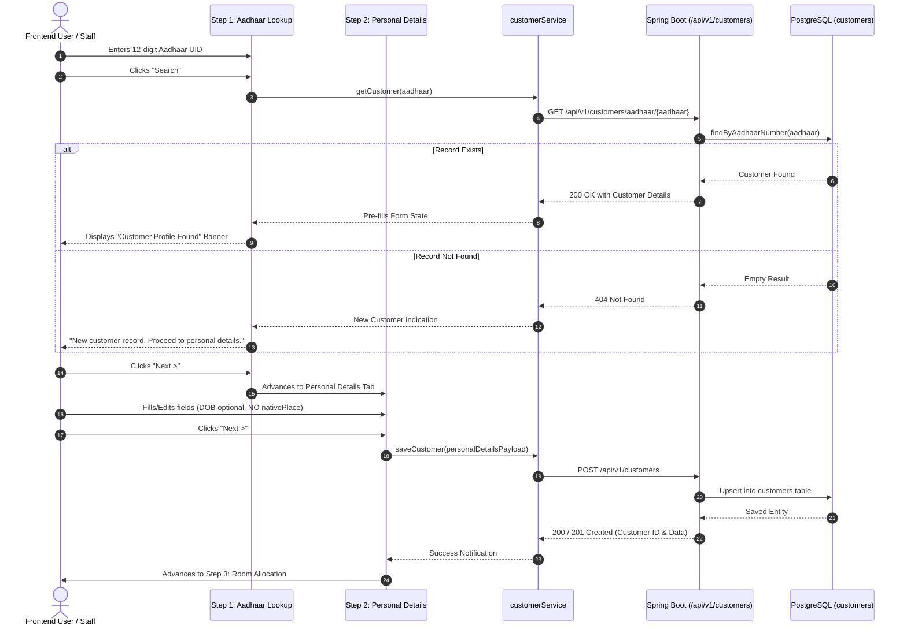

# Customer Registration: End-to-End Frontend & Backend Implementation Plan

> **File:** `Customer-Frontend-Backend-impl.md`  
> **Status:** Draft / Pending User Approval  
> **Target Directory:** `atithi/.ai/plans/`

---

## 1. Overview & Objective

This document provides a comprehensive technical plan for implementing the **Customer Registration & Management Flow** across both the **backend (`aavas`)** (Spring Boot 3/4 + JPA + PostgreSQL) and the **frontend (`atithi`)** (React 19 + TypeScript + Vite + Tailwind CSS).

### Key Business & Architectural Principles

1. **Unique Identification via Aadhaar**: Every customer in the system is uniquely identified by their 12-digit **Aadhaar Number** (`aadhaar_number`).
2. **Step 1 KYC Lookup**: Entering an Aadhaar number in Step 1 allows the system to look up existing customer records. If found, personal details are pre-filled; if not found, the user proceeds with new customer registration.
3. **Save Customer at Step 2**: Clicking **Next >** on Step 2 (Personal Details) persists/upserts the `Customer` record in the database before proceeding to room allocation.
4. **Form & Schema Adjustments**:
    - **`nativePlace`**: **Removed completely** from both the frontend form, validation schemas, and database entity. The `permanentAddress` field covers residential address.
    - **`dateOfBirth`**: Maintained in the backend entity/database schema as optional/nullable, and marked as **optional (non-required)** in the frontend form and validation schema.
5. **Customer vs. Hostel Relationship**:
    - The `customers` table represents global person identities (KYC profile uniquely tied to Aadhaar UID).
    - Hostel-specific stays, room allocations, dues, and rent records link the `Customer` to a specific `Hostel` (via Stay/Tenancy records).

---

## 2. Backend Implementation (`aavas`)

### 2.1 Database Table Schema: `customers`

The table will be created in PostgreSQL (managed by Spring Data JPA with `ddl-auto: update` or SQL migration):

```sql
CREATE TABLE customers (
    id BIGSERIAL PRIMARY KEY,
    first_name VARCHAR(100) NOT NULL,
    last_name VARCHAR(100) NOT NULL,
    full_name VARCHAR(200) NOT NULL,
    gender VARCHAR(20) NOT NULL,
    date_of_birth DATE NULL,
    mobile_number VARCHAR(15) NOT NULL,
    alt_mobile_number VARCHAR(15) NULL,
    email VARCHAR(255) NULL,
    aadhaar_number VARCHAR(12) NOT NULL UNIQUE,
    occupation VARCHAR(100) NOT NULL,
    emergency_contact_name VARCHAR(150) NOT NULL,
    emergency_contact_phone VARCHAR(15) NOT NULL,
    permanent_address TEXT NOT NULL,
    status VARCHAR(30) NOT NULL DEFAULT 'ACTIVE',
    created_at TIMESTAMP WITH TIME ZONE NOT NULL DEFAULT NOW(),
    updated_at TIMESTAMP WITH TIME ZONE NULL
);

-- Indexes for lightning-fast search & lookups
CREATE UNIQUE INDEX idx_customers_aadhaar ON customers (aadhaar_number);
CREATE INDEX idx_customers_mobile ON customers (mobile_number);
CREATE INDEX idx_customers_name ON customers (full_name);
```

#### Field Specifications Table

| Field Name              | DB Column                 | Data Type      | Nullable | Constraints & Descriptions                |
| :---------------------- | :------------------------ | :------------- | :------- | :---------------------------------------- |
| `id`                    | `id`                      | `BIGINT`       | No       | Primary Key, Auto-increment               |
| `firstName`             | `first_name`              | `VARCHAR(100)` | No       | Customer's first name                     |
| `lastName`              | `last_name`               | `VARCHAR(100)` | No       | Customer's last name                      |
| `fullName`              | `full_name`               | `VARCHAR(200)` | No       | Concatenated `firstName + ' ' + lastName` |
| `gender`                | `gender`                  | `VARCHAR(20)`  | No       | E.g. `Male`, `Female`, `Other`            |
| `dateOfBirth`           | `date_of_birth`           | `DATE`         | **Yes**  | Optional birth date                       |
| `mobileNumber`          | `mobile_number`           | `VARCHAR(15)`  | No       | 10-digit primary contact phone            |
| `altMobileNumber`       | `alt_mobile_number`       | `VARCHAR(15)`  | **Yes**  | Optional alternate contact phone          |
| `email`                 | `email`                   | `VARCHAR(255)` | **Yes**  | Optional email address                    |
| `aadhaarNumber`         | `aadhaar_number`          | `VARCHAR(12)`  | No       | **Unique, 12 digits**, primary lookup key |
| `occupation`            | `occupation`              | `VARCHAR(100)` | No       | E.g. Software Engineer, Student           |
| `emergencyContactName`  | `emergency_contact_name`  | `VARCHAR(150)` | No       | Relative / Guardian name                  |
| `emergencyContactPhone` | `emergency_contact_phone` | `VARCHAR(15)`  | No       | 10-digit emergency phone number           |
| `permanentAddress`      | `permanent_address`       | `TEXT`         | No       | Full residential street address           |
| `status`                | `status`                  | `VARCHAR(30)`  | No       | `ACTIVE`, `INACTIVE`, `BLOCKED`           |
| `createdAt`             | `created_at`              | `TIMESTAMPTZ`  | No       | Audit field from `BaseEntity`             |
| `updatedAt`             | `updated_at`              | `TIMESTAMPTZ`  | **Yes**  | Audit field from `BaseEntity`             |

> [!NOTE]
> `nativePlace` is completely omitted in accordance with user requirements.

---

### 2.2 Backend Package Structure (`aavas`)

```
aavas/src/main/java/com/atithi/aavas/
├── models/
│   └── Customer.java                 <-- JPA Entity extending BaseEntity
├── repositories/
│   └── CustomerRepository.java       <-- Spring Data JPA Repository
├── requests/
│   ├── CustomerCreateRequest.java    <-- Request DTO for creation/saving
│   └── CustomerUpdateRequest.java    <-- Request DTO for updates
├── responses/
│   ├── CustomerResponse.java         <-- Response DTO returned to client
│   └── ApiResponse.java              <-- Generic envelope (existing)
├── services/
│   └── CustomerService.java          <-- Service Interface
├── implementations/
│   └── CustomerServiceImpl.java      <-- Service Implementation
└── controllers/
    └── CustomerController.java       <-- REST Controller (/api/v1/customers)
```

---

### 2.3 Backend Code Specifications

#### 1. Entity: `Customer.java`

- Location: `com.atithi.aavas.models.Customer`
- Extends: `BaseEntity` (inherits `createdAt`, `updatedAt`)
- Annotations: `@Entity`, `@Table(name = "customers")`, `@Getter`, `@Setter`, `@Builder`, `@NoArgsConstructor`, `@AllArgsConstructor`
- Methods: Lifecycle hook `@PrePersist` and `@PreUpdate` to guarantee `fullName = firstName + " " + lastName`.

#### 2. Repository: `CustomerRepository.java`

- Location: `com.atithi.aavas.repositories.CustomerRepository`
- Extends: `JpaRepository<Customer, Long>`
- Methods:
    ```java
    Optional<Customer> findByAadhaarNumber(String aadhaarNumber);
    boolean existsByAadhaarNumber(String aadhaarNumber);
    Optional<Customer> findByMobileNumber(String mobileNumber);
    ```

#### 3. DTOs

- `CustomerCreateRequest.java` (Record with Jakarta Validation annotations: `@NotBlank`, `@Pattern(regexp = "^\\d{12}$")`, `@Pattern(regexp = "^\\d{10}$")`, `@Email`)
- `CustomerResponse.java` (Clean projection record with static factory method `fromEntity(Customer c)`)

#### 4. Service: `CustomerService.java` & `CustomerServiceImpl.java`

- `CustomerResponse saveOrUpdateCustomer(CustomerCreateRequest request)`:
    - Checks if a customer with the given Aadhaar UID already exists.
    - If exists: updates existing customer's details and saves.
    - If new: creates a new customer entity and saves.
- `CustomerResponse getCustomerByAadhaar(String aadhaarNumber)`:
    - Fetches customer by 12-digit Aadhaar UID; returns 404 if not found.
- `CustomerResponse getCustomerById(Long id)`:
    - Fetches customer by ID.
- `List<CustomerResponse> getAllCustomers()`:
    - Returns all registered customers.

#### 5. REST Controller: `CustomerController.java`

- Base Path: `@RequestMapping("/api/v1/customers")`
- Endpoints:
    | HTTP Method | Path                                        | Description                                                                               | Access        |
    | :---------- | :------------------------------------------ | :---------------------------------------------------------------------------------------- | :------------ |
    | `GET`       | `/api/v1/customers/aadhaar/{aadhaarNumber}` | Step 1 KYC Lookup: Retrieve existing customer by Aadhaar UID                              | Authenticated |
    | `POST`      | `/api/v1/customers`                         | Step 2 Save: Create or update customer record                                             | Authenticated |
    | `GET`       | `/api/v1/customers/{id}`                    | Get customer profile by ID                                                                | Authenticated |
    | `GET`       | `/api/v1/customers`                         | Get all customers list of current hostel only, so hostel specific customers only retrived | Authenticated |
    | `PUT`       | `/api/v1/customers/{id}`                    | Update existing customer details                                                          | Authenticated |

---

## 3. Frontend Implementation (`atithi`)

### 3.1 Wizard Flow Integration (Step 1 & Step 2)



---

### 3.2 Frontend File Modifications

#### 1. [types/index.ts](file:///d:/resource/Projects/Hostel%20Management/atithi/src/types/index.ts)

- Modify `Customer` interface:
    - Remove `nativePlace`.
    - Make `dateOfBirth?: string` optional.
    - Keep `permanentAddress: string`.

#### 2. [components/feature/PersonalDetailsForm.tsx](file:///d:/resource/Projects/Hostel%20Management/atithi/src/components/feature/PersonalDetailsForm.tsx)

- Remove `nativePlace` input component.
- Remove `required` attribute from `dateOfBirth` picker.
- Ensure `aadhaarNumber` is prefilled and read-only if retrieved from Step 1.

#### 3. [pages/Customers.tsx](file:///d:/resource/Projects/Hostel%20Management/atithi/src/pages/Customers.tsx)

- **Schema Update (`customerSchema`)**:
    ```ts
    const customerSchema = z.object({
        firstName: z.string().min(1, "First name is required"),
        lastName: z.string().min(1, "Last name is required"),
        gender: z.string().min(1, "Gender is required"),
        dateOfBirth: z.string().optional().or(z.literal("")), // Optional
        email: z.string().email("Invalid email address").optional().or(z.literal("")),
        mobileNumber: z.string().regex(/^\d{10}$/, "Must be a 10-digit number"),
        altMobileNumber: z
            .string()
            .regex(/^\d{10}$/, "Must be a 10-digit number")
            .optional()
            .or(z.literal("")),
        permanentAddress: z.string().min(5, "Address is too short"),
        // nativePlace: REMOVED COMPLETELY
        aadhaarNumber: z.string().regex(/^\d{12}$/, "Must be a 12-digit Aadhaar number"),
        emergencyContactName: z.string().min(1, "Emergency contact name is required"),
        emergencyContactPhone: z.string().regex(/^\d{10}$/, "Must be a 10-digit number"),
        occupation: z.string().min(1, "Occupation is required"),
        floor: z.string().min(1, "Required"),
        roomNumber: z.string().min(1, "Select a room"),
        bedNumber: z.string().optional(),
        monthlyRent: z.number().min(0, "Must be positive"),
        advanceAmount: z.number().min(0, "Must be positive"),
        amountPaid: z.number().min(0, "Must be positive"),
        previousDue: z.number().min(0, "Must be positive"),
        paymentStatus: z.enum(["Paid", "Partial", "Unpaid"]),
        joinDate: z.string().min(1, "Required"),
    });
    ```
- **Step 2 "Next >" Interceptor**:
    - When moving from `wizardStep === 2` to `3`:
        1. Validate Step 2 personal fields with `trigger(...)`.
        2. Call `customerService.saveCustomer(...)` to persist the customer in backend.
        3. Store returned customer `id` in form context.
        4. Move to Step 3 (Room Allocation).

#### 4. [api/customerService.ts](file:///d:/resource/Projects/Hostel%20Management/atithi/src/api/customerService.ts)

- Expose methods:
    - `getCustomerByAadhaar(aadhaar: string)` -> `GET /customers/aadhaar/{aadhaar}`
    - `saveCustomer(data: CustomerPersonalData)` -> `POST /customers`
    - `getCustomers()` -> `GET /customers`
    - `updateCustomer(id, data)` -> `PUT /customers/{id}`

#### 5. [constants/apiRoutes.ts](file:///d:/resource/Projects/Hostel%20Management/atithi/src/constants/apiRoutes.ts)

- Verify matching routes:
    ```ts
    CUSTOMERS: {
        GET_ALL: "/customers", // hostel specific customers only
        GET_BY_AADHAAR: (aadhaar: string) => `/customers/aadhaar/${aadhaar}`,
        SAVE: "/customers",
        GET_BY_ID: (id: string | number) => `/customers/${id}`,
        UPDATE: (id: string | number) => `/customers/${id}`,
    }
    ```

---

## 4. Verification & Testing Plan

### 4.1 Automated Backend Tests

- `CustomerRepositoryTest`: Verify `findByAadhaarNumber` and unique constraints.
- `CustomerServiceTest`: Verify customer creation, duplicate Aadhaar handling, and updates.
- `CustomerControllerTest`: Verify HTTP status codes (`200 OK`, `201 CREATED`, `404 NOT_FOUND` for lookup, `400 BAD_REQUEST` for invalid Aadhaar).

### 4.2 Frontend Verification

1. **Aadhaar Lookup**:
    - Enter invalid Aadhaar (`123`) -> see inline regex error.
    - Enter new 12-digit Aadhaar -> click "Search" -> see "Not found. Proceed to register."
    - Click "Next >" -> Step 2 opens with Aadhaar pre-filled.
2. **Personal Details Form**:
    - Verify `nativePlace` input is absent.
    - Leave `dateOfBirth` empty -> form remains valid and does not block progression.
    - Click "Next >" -> customer record saved to backend DB via POST request.
    - Verify toast/feedback indicating customer personal details saved.
3. **End-to-End**:
    - Register a customer completely.
    - Open modal again, enter the same Aadhaar in Step 1, click "Search" -> verify existing personal details are automatically pre-filled!

---

## 5. Review & User Confirmation Checklist

Please review and confirm:

- [x] Database table schema columns and types confirmed.
- [x] `nativePlace` completely removed from DB, entity, and frontend form.
- [x] `dateOfBirth` made optional in the frontend form and nullable in backend DB.
- [x] Customer persistence triggered on Step 2 "Next >".
- [x] Plan saved under `atithi/.ai/plans/Customer-Frontend-Backend-impl.md`.
