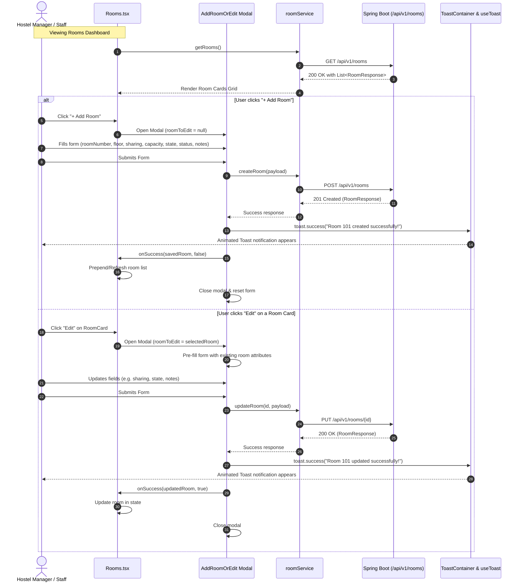

# Room Management: End-to-End Frontend & Backend Implementation Plan

> **File:** `Room-Frontend-Backend-impl.md`  
> **Status:** Draft / Pending User Approval  
> **Target Directory:** `atithi/.ai/plans/`  
> **Reference:** `Customer-Frontend-Backend-impl.md`

---

## 1. Overview & Objectives

Currently, the frontend page [Rooms.tsx](file:///d:/resource/Projects/Hostel%20Management/atithi/src/pages/Rooms.tsx) displays mock rooms stored in local memory (`localStorage` / `mockData.ts`). This plan details the end-to-end implementation to replace mock data with full database persistence in PostgreSQL via **Spring Boot (`aavas`)** and a reactive, interactive frontend UI in **React 19 + TypeScript (`atithi`)**.

### Key Feature Highlights

1. **Full Database Schema**: A dedicated `rooms` table with all required fields: `id`, `created_at`, `updated_at`, `sharing`, `max_capacity`, `floor`, `last_cleaned`, `notes`, `room_number`, `room_state`, `room_status`, and `hostel_id`.
2. **Multi-Tenant Isolation**: Rooms belong to a specific `hostel_id` obtained securely from the authenticated session (`@AuthenticationPrincipal UserPrincipal`). Rooms are unique per hostel (`UNIQUE(hostel_id, room_number)`).
3. **AddRoomOrEdit Component**: A dedicated, reusable modal component [AddRoomOrEdit.tsx](file:///d:/resource/Projects/Hostel%20Management/atithi/src/components/feature/AddRoomOrEdit.tsx) to create new rooms or modify existing rooms.
4. **Toast Feedback**: Instant, animated visual feedback on room creation and updates powered by [ToastContainer.tsx](file:///d:/resource/Projects/Hostel%20Management/atithi/src/components/common/ToastContainer.tsx) and `useToast`.
5. **Dynamic Room Grid & Status Tracking**: Visual card board displaying room numbers, floor tags, sharing tier, cleanliness status (`CLEAN`/`DIRTY`), and occupancy status (`VACANT`/`PARTIALLY FILLED`/`FILLED`).

---

## 2. Backend Implementation (`aavas`)

### 2.1 Database Table Schema: `rooms`

The table will be managed in PostgreSQL via Spring Data JPA and database migrations:

```sql
CREATE TABLE rooms (
    id BIGSERIAL PRIMARY KEY,
    room_number VARCHAR(50) NOT NULL,
    floor VARCHAR(50) NOT NULL,
    sharing INT NOT NULL CHECK (sharing > 0),
    max_capacity INT NOT NULL CHECK (max_capacity > 0),
    occupied INT NOT NULL DEFAULT 0 CHECK (occupied >= 0),
    room_state VARCHAR(20) NOT NULL DEFAULT 'CLEAN',
    room_status VARCHAR(30) NOT NULL DEFAULT 'VACANT',
    last_cleaned TIMESTAMP WITH TIME ZONE NULL,
    notes TEXT NULL,
    hostel_id BIGINT NOT NULL REFERENCES hostels(id) ON DELETE CASCADE,
    created_at TIMESTAMP WITH TIME ZONE NOT NULL DEFAULT NOW(),
    updated_at TIMESTAMP WITH TIME ZONE NULL,
    CONSTRAINT uk_hostel_room_number UNIQUE (hostel_id, room_number)
);

-- Performance indexes for tenant queries, filtering, and floor grouping
CREATE INDEX idx_rooms_hostel_id ON rooms (hostel_id);
CREATE INDEX idx_rooms_hostel_floor ON rooms (hostel_id, floor);
CREATE INDEX idx_rooms_hostel_status ON rooms (hostel_id, room_status);
CREATE INDEX idx_rooms_hostel_state ON rooms (hostel_id, room_state);
```

#### Field Specifications Table

| Field Name    | DB Column      | Data Type     | Nullable | Constraints & Description                                         |
| :------------ | :------------- | :------------ | :------- | :---------------------------------------------------------------- |
| `id`          | `id`           | `BIGINT`      | No       | Primary Key, Auto-increment                                       |
| `roomNumber`  | `room_number`  | `VARCHAR(50)` | No       | Room identifier (e.g. "101", "G-02"). Unique per hostel           |
| `floor`       | `floor`        | `VARCHAR(50)` | No       | Floor identifier (e.g. "1", "2", "Ground Floor")                  |
| `sharing`     | `sharing`      | `INT`         | No       | Bed sharing type (1 for Single, 2 for Double, 3 for Triple, etc.) |
| `maxCapacity` | `max_capacity` | `INT`         | No       | Max capacity/beds in this room (defaults to sharing)              |
| `occupied`    | `occupied`     | `INT`         | No       | Count of beds currently occupied in this room (Default: 0)        |
| `roomState`   | `room_state`   | `VARCHAR(20)` | No       | Housekeeping state: `CLEAN` or `DIRTY` (Default: `CLEAN`)         |
| `roomStatus`  | `room_status`  | `VARCHAR(30)` | No       | Occupancy state: `VACANT`, `PARTIALLY_FILLED`, `FILLED`           |
| `lastCleaned` | `last_cleaned` | `TIMESTAMPTZ` | **Yes**  | Timestamp when the room was last sanitized/cleaned                |
| `notes`       | `notes`        | `TEXT`        | **Yes**  | Notes, special amenities, or maintenance remarks                  |
| `hostelId`    | `hostel_id`    | `BIGINT`      | No       | Foreign Key referencing `hostels(id)`                             |
| `createdAt`   | `created_at`   | `TIMESTAMPTZ` | No       | Audit timestamp from `BaseEntity`                                 |
| `updatedAt`   | `updated_at`   | `TIMESTAMPTZ` | **Yes**  | Audit timestamp from `BaseEntity`                                 |

---

### 2.2 Backend Package Structure (`aavas`)

```
aavas/src/main/java/com/atithi/aavas/
├── enums/
│   ├── RoomState.java               <-- CLEAN, DIRTY
│   └── RoomStatus.java              <-- VACANT, PARTIALLY_FILLED, FILLED
├── models/
│   └── Room.java                    <-- JPA Entity extending BaseEntity
├── repositories/
│   └── RoomRepository.java          <-- Spring Data JPA Repository (Hostel scoped)
├── requests/
│   └── RoomRequest.java             <-- Request DTO for Add & Edit
├── responses/
│   └── RoomResponse.java            <-- Clean response DTO
├── services/
│   └── RoomService.java             <-- Service Interface
├── implementations/
│   └── RoomServiceImpl.java         <-- Business logic implementation
└── controllers/
    └── RoomController.java          <-- REST endpoints (/api/v1/rooms)
```

---

### 2.3 Backend Code Specifications

#### 1. Enums

- **`RoomState.java`**:
    ```java
    package com.atithi.aavas.enums;

    public enum RoomState {
        CLEAN,
        DIRTY
    }
    ```
- **`RoomStatus.java`**:
    ```java
    package com.atithi.aavas.enums;

    import com.fasterxml.jackson.annotation.JsonCreator;
    import com.fasterxml.jackson.annotation.JsonValue;

    public enum RoomStatus {
        VACANT("VACANT"),
        PARTIALLY_FILLED("PARTIALLY FILLED"),
        FILLED("FILLED");

        private final String label;

        RoomStatus(String label) {
            this.label = label;
        }

        @JsonValue
        public String getLabel() {
            return label;
        }

        @JsonCreator
        public static RoomStatus fromString(String value) {
            if (value == null) return VACANT;
            for (RoomStatus status : values()) {
                if (status.name().equalsIgnoreCase(value) ||
                    status.label.equalsIgnoreCase(value) ||
                    status.name().replace("_", " ").equalsIgnoreCase(value)) {
                    return status;
                }
            }
            return VACANT;
        }
    }
    ```

#### 2. Entity: `Room.java`

- Location: `com.atithi.aavas.models.Room`
- Extends: `BaseEntity` (inherits `createdAt`, `updatedAt`)
- Annotations: `@Entity`, `@Table(name = "rooms", uniqueConstraints = {@UniqueConstraint(name = "uk_hostel_room_number", columnNames = {"hostel_id", "room_number"})})`, `@Getter`, `@Setter`, `@Builder`, `@NoArgsConstructor`, `@AllArgsConstructor`
- Code Structure:
    ```java
    @Entity
    @Table(name = "rooms", uniqueConstraints = {
        @UniqueConstraint(name = "uk_hostel_room_number", columnNames = {"hostel_id", "room_number"})
    })
    @Getter
    @Setter
    @NoArgsConstructor
    @AllArgsConstructor
    @Builder
    public class Room extends BaseEntity {

        @Id
        @GeneratedValue(strategy = GenerationType.IDENTITY)
        private Long id;

        @Column(name = "room_number", nullable = false, length = 50)
        private String roomNumber;

        @Column(nullable = false, length = 50)
        private String floor;

        @Column(nullable = false)
        private Integer sharing;

        @Column(name = "max_capacity", nullable = false)
        private Integer maxCapacity;

        @Column(nullable = false)
        @Builder.Default
        private Integer occupied = 0;

        @Enumerated(EnumType.STRING)
        @Column(name = "room_state", nullable = false, length = 20)
        @Builder.Default
        private RoomState roomState = RoomState.CLEAN;

        @Enumerated(EnumType.STRING)
        @Column(name = "room_status", nullable = false, length = 30)
        @Builder.Default
        private RoomStatus roomStatus = RoomStatus.VACANT;

        @Column(name = "last_cleaned")
        private Instant lastCleaned;

        @Column(columnDefinition = "TEXT")
        private String notes;

        @ManyToOne(fetch = FetchType.LAZY)
        @JoinColumn(name = "hostel_id", nullable = false)
        private Hostel hostel;

        public Long getHostelId() {
            return hostel != null ? hostel.getId() : null;
        }
    }
    ```

#### 3. Repository: `RoomRepository.java`

```java
package com.atithi.aavas.repositories;

import com.atithi.aavas.models.Room;
import org.springframework.data.jpa.repository.JpaRepository;
import org.springframework.stereotype.Repository;

import java.util.List;
import java.util.Optional;

@Repository
public interface RoomRepository extends JpaRepository<Room, Long> {
    List<Room> findByHostelIdOrderByRoomNumberAsc(Long hostelId);
    List<Room> findByHostelIdAndFloorOrderByRoomNumberAsc(Long hostelId, String floor);
    Optional<Room> findByIdAndHostelId(Long id, Long hostelId);
    boolean existsByHostelIdAndRoomNumber(Long hostelId, String roomNumber);
    boolean existsByHostelIdAndRoomNumberAndIdNot(Long hostelId, String roomNumber, Long id);
}
```

#### 4. DTOs: `RoomRequest.java` and `RoomResponse.java`

- **`RoomRequest.java`**:

    ```java
    package com.atithi.aavas.requests;

    import com.atithi.aavas.enums.RoomState;
    import com.atithi.aavas.enums.RoomStatus;
    import jakarta.validation.constraints.Min;
    import jakarta.validation.constraints.NotBlank;
    import jakarta.validation.constraints.NotNull;
    import java.time.Instant;

    public record RoomRequest(
        @NotBlank(message = "Room number is required")
        String roomNumber,

        @NotBlank(message = "Floor is required")
        String floor,

        @NotNull(message = "Sharing type is required")
        @Min(value = 1, message = "Sharing must be at least 1")
        Integer sharing,

        @NotNull(message = "Maximum capacity is required")
        @Min(value = 1, message = "Max capacity must be at least 1")
        Integer maxCapacity,

        RoomState roomState,

        RoomStatus roomStatus,

        Instant lastCleaned,

        String notes
    ) {}
    ```

- **`RoomResponse.java`**:
    ```java
    package com.atithi.aavas.responses;

    import com.atithi.aavas.enums.RoomState;
    import com.atithi.aavas.enums.RoomStatus;
    import com.atithi.aavas.models.Room;
    import java.time.Instant;

    public record RoomResponse(
        Long id,
        String roomNumber,
        String floor,
        Integer sharing,
        Integer maxCapacity,
        RoomState roomState,
        RoomStatus roomStatus,
        Instant lastCleaned,
        String notes,
        Long hostelId,
        Instant createdAt,
        Instant updatedAt
    ) {
        public static RoomResponse fromEntity(Room room) {
            if (room == null) return null;
            return new RoomResponse(
                room.getId(),
                room.getRoomNumber(),
                room.getFloor(),
                room.getSharing(),
                room.getMaxCapacity(),
                room.getRoomState(),
                room.getRoomStatus(),
                room.getLastCleaned(),
                room.getNotes(),
                room.getHostelId(),
                room.getCreatedAt(),
                room.getUpdatedAt()
            );
        }
    }
    ```

#### 5. Service: `RoomService.java` & `RoomServiceImpl.java`

- Methods:
    - `List<RoomResponse> getRooms(Long hostelId, String floor)`: Returns all rooms for the authenticated hostel, optionally filtered by floor.
    - `RoomResponse getRoomById(Long hostelId, Long id)`: Fetches a single room ensuring tenant isolation.
    - `RoomResponse createRoom(Long hostelId, RoomRequest request)`:
        - Validates duplicate room number within the hostel (`existsByHostelIdAndRoomNumber`).
        - If duplicate: throws `IllegalArgumentException("Room number " + request.roomNumber() + " already exists in this hostel")`.
        - Automatically sets `lastCleaned` to `Instant.now()` if `roomState == CLEAN` and `lastCleaned == null`.
        - Persists and returns `RoomResponse`.
    - `RoomResponse updateRoom(Long hostelId, Long id, RoomRequest request)`:
        - Verifies room exists for given `hostelId`.
        - Validates duplicate room number against other rooms (`existsByHostelIdAndRoomNumberAndIdNot`).
        - Updates fields and saves.
    - `RoomResponse toggleCleanStatus(Long hostelId, Long id)`:
        - Toggles `roomState` between `CLEAN` and `DIRTY`.
        - If transitioning to `CLEAN`, updates `lastCleaned` to current timestamp.
    - `void deleteRoom(Long hostelId, Long id)`: Safely deletes a vacant room.

#### 6. REST Controller: `RoomController.java`

- Base Path: `@RequestMapping("/api/v1/rooms")`
- Endpoints:
    | HTTP Method | Path                              | Description                                                         | Access        |
    | :---------- | :-------------------------------- | :------------------------------------------------------------------ | :------------ |
    | `GET`       | `/api/v1/rooms`                   | Fetch all rooms for current hostel (optional `?floor=` query param) | Authenticated |
    | `GET`       | `/api/v1/rooms/{id}`              | Fetch room details by ID                                            | Authenticated |
    | `POST`      | `/api/v1/rooms`                   | Create a new room in current hostel                                 | Authenticated |
    | `PUT`       | `/api/v1/rooms/{id}`              | Update existing room details                                        | Authenticated |
    | `PATCH`     | `/api/v1/rooms/{id}/toggle-clean` | Quick toggle of room cleanliness (`CLEAN` <-> `DIRTY`)              | Authenticated |
    | `DELETE`    | `/api/v1/rooms/{id}`              | Delete room if vacant                                               | Authenticated |

---

## 3. Frontend Implementation (`atithi`)

### 3.1 Flow & Architecture Sequence Diagram



---

### 3.2 Frontend File Specifications

#### 1. TypeScript Types: [types/index.ts](file:///d:/resource/Projects/Hostel%20Management/atithi/src/types/index.ts)

Update `Room` type and define enums/requests:

```ts
export type RoomState = "CLEAN" | "DIRTY";
export type RoomStatus = "VACANT" | "PARTIALLY FILLED" | "FILLED";

export interface Room {
    id: string | number;
    roomNumber: string;
    floor: string;
    sharing: number;
    maxCapacity: number;
    roomState: RoomState;
    roomStatus: RoomStatus;
    lastCleaned?: string | null;
    notes?: string | null;
    hostelId?: number;
    createdAt?: string;
    updatedAt?: string;

    // Visual/Backwards compatibility helpers
    capacity?: number; // alias of maxCapacity
    occupiedBeds?: number; // calculated or linked stays
    availableBeds?: number; // maxCapacity - occupiedBeds
    cleanStatus?: "CLEAN" | "DIRTY" | "INSPECTED"; // alias of roomState
    period?: string;
    vipStatus?: boolean;
    alertDot?: boolean;
}

export interface RoomFormData {
    roomNumber: string;
    floor: string;
    sharing: number;
    maxCapacity: number;
    roomState: RoomState;
    roomStatus: RoomStatus;
    notes?: string;
}
```

---

#### 2. Component: [components/feature/AddRoomOrEdit.tsx](file:///d:/resource/Projects/Hostel%20Management/atithi/src/components/feature/AddRoomOrEdit.tsx) `[NEW]`

A dedicated, accessible, and reactive form component with validation:

- **Validation Schema (Zod)**:
    ```ts
    const roomFormSchema = z.object({
        roomNumber: z.string().trim().min(1, "Room number is required"),
        floor: z.string().trim().min(1, "Floor is required"),
        sharing: z.number().int().min(1, "Sharing must be at least 1 person"),
        maxCapacity: z.number().int().min(1, "Capacity must be at least 1 bed"),
        roomState: z.enum(["CLEAN", "DIRTY"]),
        roomStatus: z.enum(["VACANT", "PARTIALLY FILLED", "FILLED"]),
        notes: z.string().optional().or(z.literal("")),
    });
    ```
- **Component Props**:
    ```ts
    interface AddRoomOrEditProps {
        isOpen: boolean;
        onClose: () => void;
        roomToEdit?: Room | null; // Null = Add mode, Object = Edit mode
        onSuccess?: (savedRoom: Room, isEdit: boolean) => void;
    }
    ```
- **Form UI Layout & Ergonomics**:
    - **Header**: "Add New Room" / "Edit Room #{roomNumber}" with dynamic icon.
    - **Room Number Input**: Text input (e.g. "101", "G-02").
    - **Floor Selector/Input**: Quick options (Ground, 1, 2, 3, 4) or custom text input.
    - **Sharing Preset Selector**: Interactive sharing pill buttons (`1-Sharing (Single)`, `2-Sharing (Double)`, `3-Sharing (Triple)`, `4-Sharing`, `5+`). When selected, automatically syncs `maxCapacity = sharing` while still allowing custom override.
    - **Max Capacity**: Number input with +/- steppers.
    - **Room State Selector**: Radio/Pill toggle between `CLEAN` (Emerald) and `DIRTY` (Amber/Rose).
    - **Room Status Selector**: Radio/Pill toggle between `VACANT` (Green), `PARTIALLY FILLED` (Amber), and `FILLED` (Rose).
    - **Notes Textarea**: Optional notes for special amenities, maintenance alerts, or bed placement.
    - **Toast Triggers**:
        ```ts
        const { toast } = useToast();

        // On Add:
        toast.success(`Room ${data.roomNumber} added successfully to Floor ${data.floor}.`);

        // On Edit:
        toast.success(`Room ${data.roomNumber} updated successfully.`);

        // On Error:
        toast.error(err.message || "Failed to save room. Please try again.");
        ```

---

#### 3. Component: [components/common/RoomCard.tsx](file:///d:/resource/Projects/Hostel%20Management/atithi/src/components/common/RoomCard.tsx) `[MODIFY]`

Enhance the room card to:

1. Render real `room.sharing` tag (e.g., `"2-Sharing"`).
2. Display `room.roomState` badge (`CLEAN` / `DIRTY`) and `room.roomStatus` indicator (`VACANT`, `PARTIALLY FILLED`, `FILLED`).
3. Add a dedicated **Edit Button** (pencil icon) that stops propagation and triggers `onEdit(room)`.
4. Allow clicking the housekeeping badge to quickly toggle `CLEAN` <-> `DIRTY` with a toast alert.

---

#### 4. Page: [pages/Rooms.tsx](file:///d:/resource/Projects/Hostel%20Management/atithi/src/pages/Rooms.tsx) `[MODIFY]`

Replace mock-only state with live API data:

1. State management:
    - `rooms: Room[]`
    - `isLoading: boolean`
    - `selectedRoomToEdit: Room | null`
    - `isModalOpen: boolean`
    - `searchTerm: string`
    - `selectedFloor: string`
2. Fetch rooms on mount using `roomService.getRooms()`.
3. "+ Add Room" button opens `<AddRoomOrEdit isOpen={isModalOpen} roomToEdit={null} ... />`.
4. Clicking edit on any card opens `<AddRoomOrEdit isOpen={isModalOpen} roomToEdit={selectedRoomToEdit} ... />`.
5. On modal success callback:
    - Inserts or replaces room in state.
    - Refreshes floor list tabs.

---

#### 5. Service: [api/roomService.ts](file:///d:/resource/Projects/Hostel%20Management/atithi/src/api/roomService.ts) `[MODIFY]`

Update service with full CRUD methods:

```ts
class RoomService extends BaseService {
    async getRooms(floor?: string): Promise<APIResponse<Room[]>> {
        const url =
            floor && floor !== "All"
                ? `${API_ROUTES.ROOMS.GET_ALL}?floor=${encodeURIComponent(floor)}`
                : API_ROUTES.ROOMS.GET_ALL;
        return this.get<Room[]>(url);
    }

    async getRoomById(id: string | number): Promise<APIResponse<Room>> {
        return this.get<Room>(API_ROUTES.ROOMS.GET_BY_ID(id));
    }

    async createRoom(room: RoomFormData): Promise<APIResponse<Room>> {
        return this.post<Room>(API_ROUTES.ROOMS.CREATE, room);
    }

    async updateRoom(id: string | number, room: RoomFormData): Promise<APIResponse<Room>> {
        return this.put<Room>(API_ROUTES.ROOMS.UPDATE(id), room);
    }

    async toggleRoomCleanStatus(id: string | number): Promise<APIResponse<Room>> {
        return this.patch<Room>(API_ROUTES.ROOMS.TOGGLE_CLEAN(id));
    }

    async deleteRoom(id: string | number): Promise<APIResponse<void>> {
        return this.delete<void>(API_ROUTES.ROOMS.DELETE(id));
    }
}
```

---

#### 6. Constants: [constants/apiRoutes.ts](file:///d:/resource/Projects/Hostel%20Management/atithi/src/constants/apiRoutes.ts) `[MODIFY]`

Update `API_ROUTES.ROOMS`:

```ts
ROOMS: {
    GET_ALL: "/rooms",
    GET_BY_ID: (id: string | number) => `/rooms/${id}`,
    CREATE: "/rooms",
    UPDATE: (id: string | number) => `/rooms/${id}`,
    TOGGLE_CLEAN: (id: string | number) => `/rooms/${id}/toggle-clean`,
    DELETE: (id: string | number) => `/rooms/${id}`,
},
```

---

## 4. Toast Notification Integration

Toast notifications will strictly utilize the project's existing [ToastContainer.tsx](file:///d:/resource/Projects/Hostel%20Management/atithi/src/components/common/ToastContainer.tsx) via `useToast()` from [ToastContext.tsx](file:///d:/resource/Projects/Hostel%20Management/atithi/src/context/ToastContext.tsx):

```tsx
import { useToast } from '@/context/ToastContext';

export const AddRoomOrEdit: React.FC<AddRoomOrEditProps> = ({ ... }) => {
    const { toast } = useToast();

    const onSubmit = async (data: RoomFormData) => {
        try {
            if (isEdit && roomToEdit) {
                const response = await roomService.updateRoom(roomToEdit.id, data);
                toast.success(`Room ${data.roomNumber} updated successfully!`);
                onSuccess?.(response.data, true);
            } else {
                const response = await roomService.createRoom(data);
                toast.success(`Room ${data.roomNumber} created successfully on Floor ${data.floor}!`);
                onSuccess?.(response.data, false);
            }
            onClose();
        } catch (error: any) {
            toast.error(error?.description || error?.message || 'Failed to save room details.');
        }
    };
    // ...
};
```

This ensures full consistency with the design system, auto-dismiss progress bars, and emerald/rose/amber styling.

---

## 5. Verification & Testing Plan

### 5.1 Automated Backend Verification

1. **`RoomRepositoryTest`**:
    - Verify room creation and retrieval by `hostelId`.
    - Verify unique constraint `(hostel_id, room_number)` prevents duplicates in the same hostel.
    - Verify identical room numbers can exist in different hostels (multi-tenancy check).
2. **`RoomServiceTest`**:
    - Verify `createRoom` sets correct defaults (`roomState = CLEAN`, `roomStatus = VACANT`).
    - Verify `updateRoom` updates fields and prevents conflict with existing room numbers.
    - Verify `toggleCleanStatus` flips `roomState` and updates `lastCleaned`.
3. **`RoomControllerTest`**:
    - Test `GET /api/v1/rooms` returns `200 OK` with list.
    - Test `POST /api/v1/rooms` with valid payload returns `201 CREATED`.
    - Test `POST /api/v1/rooms` with missing roomNumber or invalid sharing returns `400 BAD_REQUEST`.

### 5.2 Manual UI / End-to-End Verification

1. **Room Creation Flow**:
    - Navigate to `/rooms`.
    - Click **+ Add Room**.
    - Enter Room Number `501`, Floor `5`, Sharing `3`, State `CLEAN`, Status `VACANT`, Notes `Air conditioned`.
    - Click **Save Room**.
    - Verify green success toast appears from [ToastContainer.tsx](file:///d:/resource/Projects/Hostel%20Management/atithi/src/components/common/ToastContainer.tsx) with the message: _"Room 501 created successfully on Floor 5!"_.
    - Verify Room `501` card appears on the board.
2. **Room Edit Flow**:
    - Click the **Edit** icon on Room `501`.
    - Change Sharing from `3` to `2` and Status to `PARTIALLY FILLED`.
    - Click **Update Room**.
    - Verify toast appears: _"Room 501 updated successfully."_.
    - Verify Room card immediately reflects updated sharing and occupancy status.
3. **Duplicate Room Validation**:
    - Attempt to add another room with number `501` on Floor `5`.
    - Verify error toast appears from backend indicating room number already exists.
4. **Housekeeping Quick Toggle**:
    - Click the cleanliness status badge on any room card.
    - Verify status toggles between `CLEAN` and `DIRTY` with an informative toast notification.

---

## 6. Review & User Confirmation Checklist

Please review and confirm:

- [x] Database table schema columns (`id`, `created_at`, `updated_at`, `sharing`, `max_capacity`, `floor`, `last_cleaned`, `notes`, `room_number`, `room_state`, `room_status`, `hostel_id`) confirmed.
- [x] Multi-tenant isolation via `hostel_id` and unique constraint `(hostel_id, room_number)`.
- [x] `AddRoomOrEdit` component created to handle both creation and editing forms.
- [x] Visual toast notifications implemented via [ToastContainer.tsx](file:///d:/resource/Projects/Hostel%20Management/atithi/src/components/common/ToastContainer.tsx) on save and update.
- [x] File saved under `atithi/.ai/plans/Room-Frontend-Backend-impl.md`.
