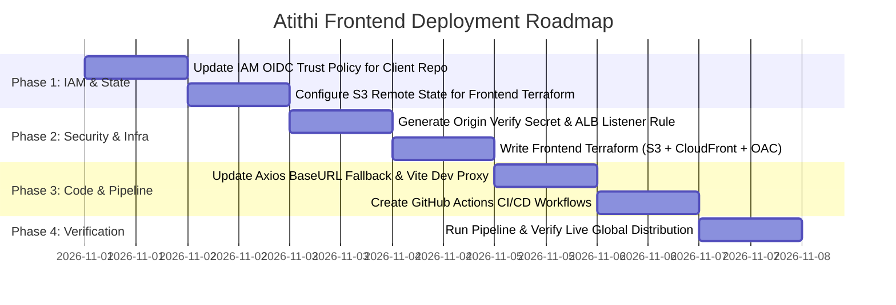

# Atithi Frontend AWS Deployment — Master Architectural & Execution Plan

> **Project**: Atithi Frontend (Client SPA)  
> **Repository**: `Nagarajukasarla/atithi-hostel-client` (Branch: `master`)  
> **Framework**: React 19 + TypeScript + Vite + Tailwind CSS  
> **Target Cloud**: Amazon Web Services (AWS) — Region: `ap-south-1` (Mumbai)  
> **Status**: 📋 **AWAITING USER CONFIRMATION (DO NOT DEPLOY WITHOUT CONFIRMATION)**  

---

## 1. Executive Summary & Core Objectives

The goal is to deploy the Atithi Frontend as a **robust, highly scalable, cost-optimal, and production-grade** web application on AWS, while fulfilling all architectural and operational requirements:

1. **Independent Deployments**: Frontend and backend are completely decoupled. Pushing code to `atithi-hostel-client` triggers a dedicated GitHub Actions workflow that builds and deploys in under 30 seconds without restarting or affecting the backend.
2. **Single Public Entry Point**: The frontend is served globally via **Amazon CloudFront** edge network over HTTPS with TLS 1.3, automatic Brotli/Gzip compression, and DDoS protection.
3. **Backend Protection & Restriction**: The backend Application Load Balancer (`atithi-dev-alb`) will **NO LONGER be directly accessible from the public internet**. Only requests originating from the Atithi CloudFront distribution (carrying an encrypted custom origin verification secret header) will be accepted. Direct browser or bot requests to the ALB will be rejected with `HTTP 403 Forbidden`.
4. **Zero-Configuration Backend Discovery (No Environment Variables)**: Through **CloudFront Multi-Origin Routing**, CloudFront serves the SPA static assets on `/*` and seamlessly reverse-proxies `/api/*` and `/actuator/*` directly to the backend ALB on the **exact same domain**. The frontend simply calls `/api/v1/...` as relative paths.
   - **Zero CORS configuration required between browser and ALB**.
   - **Zero hardcoded backend URLs in the frontend build bundle**.
   - If the backend ALB is ever modified or migrated, the frontend build is completely unaffected.
5. **No Duplicate Infrastructure**: Reuses the existing backend ALB, VPC, and networking. Zero duplicate NAT gateways or load balancers are provisioned.
6. **Near-Zero Additional Cost**: Static hosting on private S3 + CloudFront edge caching leverages the AWS Always-Free Tier (1 TB data transfer/mo + 10M requests/mo), costing **<$0.50 / month**.

---

## 2. Target Production Architecture

```mermaid
flowchart TD
    User["🌐 End-User Browser / Mobile"] -->|HTTPS :443| CF["⚡ Amazon CloudFront Distribution (Global Edge PoPs)"]

    subgraph AWS_CloudFront["CloudFront Edge Routing & Caching"]
        CF -->|Route: /* (HTML, CSS, JS, Assets)| S3_Origin["Origin 1: S3 Private Bucket (atithi-frontend-551626543871)"]
        CF -->|Route: /api/* & /actuator/* (Bypass Cache + Inject Secret Header)| ALB_Origin["Origin 2: Backend ALB (atithi-dev-alb)"]
    end

    subgraph S3_Security["S3 Static Website Security"]
        S3_Origin -->|Protected via| OAC["Origin Access Control (OAC)"]
        OAC --> S3_Store[("Private S3 Bucket\n- Public Access: BLOCKED\n- Encryption: AES-256\n- Versioning: Enabled")]
    end

    subgraph Backend_Security["AWS ap-south-1 (VPC: vpc-058c5dd8e8c8dbfdb)"]
        ALB_Origin -->|HTTP :80 with Header 'X-Origin-Verify'| ALB["Application Load Balancer (atithi-dev-alb)"]
        
        DirectPublic["🚫 Direct Public Traffic to ALB"] -.->|Missing 'X-Origin-Verify' Header| Block["⛔ HTTP 403 Forbidden\nAccess Denied"]
        
        ALB -->|Forward Header Match| TG["Target Group: atithi-dev-app-tg :8080"]
        TG --> ECS["ECS Fargate Container (atithi-server)"]
        ECS --> RDS[("RDS PostgreSQL (atithi-dev-postgres)")]
    end
```

---

## 3. Detailed Architectural Components

### A. Storage & Caching Layer (S3 + CloudFront)
- **S3 Bucket (`atithi-frontend-551626543871`)**:
  - `block_public_acls = true`
  - `block_public_policy = true`
  - `ignore_public_acls = true`
  - `restrict_public_buckets = true`
  - All direct public internet access is completely blocked.
  - Bucket policy allows read access **only** to the CloudFront Distribution via **AWS Origin Access Control (OAC)** (`aws_cloudfront_origin_access_control`).
- **CloudFront Distribution**:
  - **Viewer Protocol Policy**: `redirect-to-https` (forces secure HTTPS).
  - **HTTP Version**: `http2and3` (HTTP/3 enabled for ultra-fast mobile and web loading).
  - **Compression**: Automatic Brotli & Gzip enabled.
  - **SPA Client-Side Routing (React Router Support)**:
    - In SPAs, routes like `/login`, `/dashboard`, or `/rooms` do not exist as physical files in S3.
    - CloudFront Custom Error Responses:
      - `HTTP 403 Forbidden` ➔ Response Page: `/index.html` (HTTP Status: `200 OK`)
      - `HTTP 404 Not Found` ➔ Response Page: `/index.html` (HTTP Status: `200 OK`)
      - Error Caching Minimum TTL: `0 seconds`.

### B. Multi-Origin Reverse Proxy & Secret Header Verification
- **Origin 1 (Static Assets)**: Points to S3 bucket via OAC.
  - Path pattern: Default (`*`)
  - Cache Policy: `Managed-CachingOptimized` (1-year TTL for versioned/hashed assets like `.js` and `.css`).
- **Origin 2 (Spring Boot API)**: Points to `atithi-dev-alb-*.ap-south-1.elb.amazonaws.com`.
  - Path patterns: `/api/*` and `/actuator/*`
  - Cache Policy: `Managed-CachingDisabled` (ensures zero caching of API responses; real-time transactional data).
  - Origin Request Policy: `Managed-AllViewer` (forwards all query strings, headers, cookies, and HTTP methods: `GET, POST, PUT, DELETE, PATCH, OPTIONS`).
  - **Custom Origin Header Injection**:
    - CloudFront automatically attaches a custom header to every request sent to the ALB:
      ```text
      Header Name:  X-Origin-Verify
      Header Value: <Cryptographically-Secure-Secret-Stored-In-SecretsManager>
      ```

### C. Backend ALB Security Hardening
- In the backend ALB listener:
  - **Priority 1 Rule (CloudFront Origin Verification)**:
    - Condition: `http-header` `X-Origin-Verify` equals `<secret>`.
    - Action: Forward to `atithi-dev-app-tg`.
  - **Default Rule (Catch-All Protection)**:
    - Action: Fixed Response `403 Forbidden`:
      ```json
      {
        "status": 403,
        "error": "Forbidden",
        "message": "Direct access to backend is restricted. Requests must route through Atithi Frontend."
      }
      ```
- **Result**: Direct traffic to `http://atithi-dev-alb-...` receives an immediate 403. Only requests routed through CloudFront can reach the Spring Boot container.

### D. Auto-Configurable Frontend Discovery (Zero Env Vars)
- In `atithi/src/api/axiosInstance.ts`:
  ```typescript
  const axiosInstance = axios.create({
      baseURL: import.meta.env.VITE_API_BASE_URL || "/api/v1",
      withCredentials: true,
  });
  ```
- In Local Development (`pnpm run dev`):
  - Vite dev server proxies `/api` to `http://localhost:8080`.
- In Production (`https://<cloudfront-domain>/`):
  - All Axios requests go to `/api/v1/...` on the same domain.
  - Browser automatically sends cookies/session headers with no cross-origin restrictions.
  - **No environment variable needed at build time.**

---

## 4. Phased Implementation Roadmap



### Phase 1 — IAM OIDC Role Trust Policy Update & State Configuration
1. **GitHub Repository**: `Nagarajukasarla/atithi-hostel-client`
2. **IAM OIDC Role**: Update the existing `atithi-github-actions-role` trust policy to allow the frontend client repository:
   ```json
   {
       "Effect": "Allow",
       "Action": "sts:AssumeRoleWithWebIdentity",
       "Principal": {
           "Federated": "arn:aws:iam::551626543871:oidc-provider/token.actions.githubusercontent.com"
       },
       "Condition": {
           "StringEquals": {
               "token.actions.githubusercontent.com:aud": "sts.amazonaws.com"
           },
           "StringLike": {
               "token.actions.githubusercontent.com:sub": [
                   "repo:Nagarajukasarla/atithi-hostel-server:*",
                   "repo:Nagarajukasarla/atithi-hostel-client:*"
               ]
           }
       }
   }
   ```
3. **Terraform S3 Remote State**:
   - Bucket: `atithi-terraform-state-551626543871` (existing)
   - State Key for Frontend: `frontend/terraform.tfstate` (isolated from backend state `dev/terraform.tfstate`).

### Phase 2 — Terraform Infrastructure (`atithi/terraform/`)
Create the dedicated Terraform configuration in `d:\resource\Projects\Hostel Management\atithi\terraform\`:
- `backend.tf`: S3 remote state configuration.
- `provider.tf`: AWS provider (`ap-south-1`).
- `data.tf`: Reads existing ALB DNS and listener from backend Terraform remote state or AWS tags.
- `s3.tf`: S3 bucket, versioning, encryption, public access block, and OAC bucket policy.
- `cloudfront.tf`: CloudFront distribution with S3 origin (OAC), ALB origin (`X-Origin-Verify` header), cache behaviors (`/*`, `/api/*`, `/actuator/*`), and SPA custom error responses (403/404 ➔ `/index.html`).
- `alb_rule.tf`: Adds the ALB listener rule to verify `X-Origin-Verify` header and return 403 on direct access.
- `variables.tf` & `outputs.tf`: Exports `cloudfront_domain_name`, `s3_bucket_name`, and `distribution_id`.

### Phase 3 — Frontend Code Optimization (Auto-Configuration)
1. **`axiosInstance.ts`**:
   - Ensure default `baseURL` fallback to `/api/v1` when `VITE_API_BASE_URL` is omitted.
2. **`vite.config.ts`**:
   - Add local development server proxy to avoid any CORS issues when testing locally:
     ```typescript
     server: {
       proxy: {
         '/api': {
           target: 'http://localhost:8080',
           changeOrigin: true,
         },
       },
     }
     ```

### Phase 4 — GitHub Actions Automated CI/CD Pipeline
Create `.github/workflows/` in the `atithi` repository:

1. **`frontend-ci.yml` (Pull Request & Feature Branch Verification)**:
   - Triggers on PRs to `master`.
   - Steps:
     - Checkout code.
     - Install `pnpm` via `pnpm/action-setup@v4`.
     - Setup Node.js 20 with `pnpm` cache via `actions/setup-node@v4`.
     - Install dependencies (`pnpm install --frozen-lockfile`).
     - Run linter (`pnpm run lint`).
     - Run TypeScript check and build test (`pnpm run build`).

2. **`frontend-cd.yml` (Automated Production Deployment)**:
   - Triggers on `push` to `master` (and manual `workflow_dispatch`).
   - Permissions: `id-token: write`, `contents: read`.
   - Steps:
     - **Step 1: Authenticate to AWS via OIDC**:
       ```yaml
       - name: Configure AWS Credentials via OIDC
         uses: aws-actions/configure-aws-credentials@v4
         with:
           role-to-assume: ${{ vars.AWS_ROLE_ARN }}
           aws-region: ${{ vars.AWS_REGION || 'ap-south-1' }}
       ```
     - **Step 2: Install pnpm & Build Production Artifacts**:
       ```yaml
       - name: Install pnpm
         uses: pnpm/action-setup@v4
         with:
           version: 11.5.2

       - name: Setup Node.js 20
         uses: actions/setup-node@v4
         with:
           node-version: 20
           cache: 'pnpm'

       - name: Install dependencies
         run: pnpm install --frozen-lockfile

       - name: Build static SPA
         run: pnpm run build
       ```
       Produces clean, minified production assets in `dist/`.
     - **Step 3: Deploy to S3 with Optimal Cache Headers**:
       ```bash
       # Upload hashed assets (JS/CSS/images) with 1-year immutable cache:
       aws s3 sync dist/ s3://${{ vars.FRONTEND_S3_BUCKET }} \
         --delete \
         --exclude "index.html" \
         --cache-control "public, max-age=31536000, immutable"

       # Upload index.html with no-cache (instant updates on every deployment):
       aws s3 cp dist/index.html s3://${{ vars.FRONTEND_S3_BUCKET }}/index.html \
         --cache-control "no-cache, no-store, must-revalidate"
       ```
     - **Step 4: Invalidate CloudFront Cache**:
       ```bash
       aws cloudfront create-invalidation \
         --distribution-id ${{ vars.CLOUDFRONT_DISTRIBUTION_ID }} \
         --paths "/*"
       ```
     - Deployment completed in **< 30 seconds**!

---

## 5. Master Implementation Checklist & Division of Responsibilities

The implementation is executed sequentially across 7 clear steps:

| Step | Action Item | Assigned To | Status | Details |
| :---: | :--- | :---: | :---: | :--- |
| **1** | **Update AWS IAM OIDC Trust Policy** | 👤 **USER** | ✅ **DONE** | Authorized `atithi-hostel-client` in `atithi-github-actions-role` trust policy. |
| **2** | **Frontend Code Auto-Config & Dev Proxy (`pnpm`)** | 🤖 **AGENT** | ✅ **DONE** | Updated `axiosInstance.ts` (`/api/v1` fallback), `vite.config.ts` (dev proxy), verified `pnpm run build` succeeds (31s, 0 errors). |
| **3** | **Backend ALB Protection & Secret Verification** | 🤖 **AGENT** | ✅ **DONE & VERIFIED** | Deployed listener rules (Rules 10, 20, 500). Direct `/api/*` blocked with `403 Forbidden`; header `X-Origin-Verify` forwards to Spring Boot. |
| **4** | **Frontend Terraform Infrastructure (`atithi/terraform/`)** | 🤖 **AGENT** | ✅ **DONE & LIVE** | Provisioned S3 (`atithi-frontend-551626543871`) & CloudFront (`d2dk2x85a04vx5.cloudfront.net`, Dist ID: `E3IJXZS95HCP8S`). |
| **5** | **GitHub Actions Workflows (Strictly `pnpm`)** | 🤖 **AGENT** | ✅ **DONE** | Created `.github/workflows/frontend-ci.yml` and `frontend-cd.yml` with `pnpm/action-setup@v4`. |
| **6** | **Set GitHub Repository Variables** | 👤 **USER** | ⏳ **ACTION REQUIRED NOW** | In GitHub `atithi-hostel-client` Settings, add `AWS_ROLE_ARN` (`arn:aws:iam::551626543871:role/atithi-github-actions-role`). |
| **7** | **Push to GitHub & Live Verification** | 👤 + 🤖 | ⏳ **UPCOMING** | Push to `master`, monitor workflow, verify live CloudFront HTTPS site, and verify direct ALB 403 block. |

---

### Step 1 Detail for the USER (Action Required Now):
**Where**: AWS IAM Console ➔ Roles ➔ [`atithi-github-actions-role`](https://console.aws.amazon.com/iam/home#/roles/atithi-github-actions-role)  
**Tab**: **Trust relationships** ➔ Click **Edit trust policy**  
**Action**: Replace the policy with this JSON to authorize both backend and frontend repositories:

```json
{
    "Version": "2012-10-17",
    "Statement": [
        {
            "Effect": "Allow",
            "Principal": {
                "Federated": "arn:aws:iam::551626543871:oidc-provider/token.actions.githubusercontent.com"
            },
            "Action": "sts:AssumeRoleWithWebIdentity",
            "Condition": {
                "StringEquals": {
                    "token.actions.githubusercontent.com:aud": "sts.amazonaws.com"
                },
                "StringLike": {
                    "token.actions.githubusercontent.com:sub": [
                        "repo:Nagarajukasarla/atithi-hostel-server:*",
                        "repo:Nagarajukasarla/atithi-hostel-client:*"
                    ]
                }
            }
        }
    ]
}
```
*Click **Update policy** to save.*

---

## 6. Financial & Operational Impact

| Resource | Service | Monthly Cost | Cost Justification |
| :--- | :--- | :--- | :--- |
| **Static Assets Hosting** | Amazon S3 | **~$0.01 / mo** | ~5 MB static assets. First 5 GB free. |
| **Global Content Delivery** | Amazon CloudFront | **$0.00 / mo** | AWS Free Tier covers **1 TB data transfer out** and **10,000,000 HTTP/HTTPS requests** every month permanently. |
| **SSL/TLS Certificate** | AWS Certificate Manager | **$0.00 / mo** | Free AWS-managed SSL certificate (or default `*.cloudfront.net` SSL). |
| **Origin Verification Secret** | AWS Secrets Manager / SSM | **$0.00 / mo** | Using SSM Parameter Store (Free) or existing Secrets Manager. |
| **Networking & Compute** | ALB, NAT, ECS, RDS | **$0.00 additional** | Reuses already running backend infrastructure. Zero duplicate costs. |
| **Total Additional Cost** | | **<$0.50 / month** | Outstanding scalability with near-zero marginal cost. |

---

## 7. Next Step

Please review the architectural plan above. Once you confirm, we will begin:
1. Updating the IAM OIDC Role trust policy to allow `atithi-hostel-client`.
2. Writing the Terraform infrastructure in `atithi/terraform/`.
3. Setting up the GitHub Actions CI/CD pipeline.
